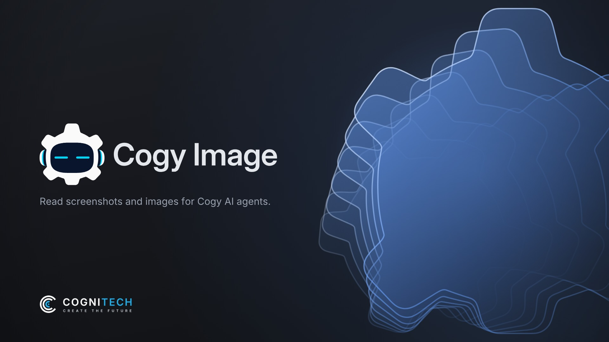

# Cogy Image

Cogy Image reads screenshots and other images for the Cogy system. A caller
sends an image, with a caption saying what it expects the image to show, and
gets back a short description of what is visible and of any visible defects.
It does not take the caption, or any text in the image, as true or as
instructions.

Cogy Image runs on its own machine on Cogy Server's private network and uses a
local vision-language model. Images never leave the network. Its installer
puts everything it needs on the machine: the model server, the model, Python,
the service and the firewall rules.

Cogy Image is part of the Cogy system:

- [Cogy Code](https://github.com/CogyCode/cogy-code): secure, self-hosted
  software development with Cogy AI agents. Its agents send screenshots to
  Cogy Image.
- [Cogy Server](https://github.com/CogyCode/cogy-server): identity, access and
  governance for Cogy AI agents. It runs the private network and is the only
  caller Cogy Image admits.

## Before you install

**Install Cogy Code and Cogy Server first.** Cogy Image does not work on its
own:

1. **Cogy Server** must be installed and running. It runs the private network
   that Cogy Image joins, gives out the join key, and is the only machine
   allowed to call Cogy Image.
2. **Cogy Code** must be installed and connected to Cogy Server. Its agents
   are what send screenshots to be read.

Then install Cogy Image on its own machine with the build's installer: see
[Builds](#builds).

## How it works

```
Cogy Code agent (view_screenshot, images: server)
    │  POST /api/images/inspect  {image, caption}   through the agent's node
    ▼
Cogy Server
    │  POST /inspect  {image, caption}
    ▼
Image service (private address, port 8812)
    │  checks the image, builds the prompt, returns the findings
    ▼
Model server (local only)
    │
    ▼
Vision-language model on the machine's GPU or NPU
    │  findings
    ▼
Cogy Server
    │  findings
    ▼
Cogy Code agent
```

- **Private:** the service listens only on the machine's private network
  address, and the firewall admits only Cogy Server.
- **Standalone:** nothing else runs on the machine, so the model stays loaded
  and no other model is swapped out to read an image.
- **Unattended:** the services start at boot and restart after a failure.

## Devices

Cogy Image is not made for one machine. Each build targets a kind of
hardware: the OpenVINO build any Intel AI PC with an Intel GPU, and the
VENTUNO Q build boards with the Qualcomm Dragonwing IQ8 chip. The machines
below are the ones it has been tested on. Both run the model on the device
itself, with no cloud service.

### Intel AI PC

An Intel AI PC is a laptop or desktop with an Intel Core Ultra processor,
which combines a CPU, a GPU and an NPU (neural processing unit) on one chip,
each able to run AI models. Cogy Image has been tested on two:

| | Core Ultra 7 258V ("Lunar Lake") | Core Ultra X7 358H ("Panther Lake") |
|---|---|---|
| CPU | 8 cores (4 performance, 4 efficient), up to 4.8 GHz | 16 cores, up to 4.8 GHz |
| GPU | Intel Arc 140V: 8 Xe2 cores, about 64 TOPS (INT8) | Intel Arc B390: 12 Xe3 cores |
| NPU | About 47 TOPS (INT8) | Intel NPU |
| Memory | 32 GB LPDDR5X-8533 on the processor package, shared by the CPU, GPU and NPU | 64 GB at 8533 MT/s, shared by the CPU, GPU and NPU |
| Storage | — | 2 TB SSD |
| OS | Windows 11 | Windows 11, bare metal, in a cloud data centre in Oregon, USA |

The 258V's TOPS figures are Intel's, as published by Intel and in
third-party spec listings.

**Use in Cogy Image.** The [openvino/](openvino/) build runs
Qwen3-VL-8B-Instruct, quantised to INT4, on the GPU through OpenVINO Model
Server. The GPU has the most AI throughput of the three units and runs
OpenVINO's continuous batching. The build reads images at up to 1920 × 1080
pixels (larger images are scaled down) and runs two inspections at once,
within a 16,384-token context each:

| | Core Ultra 7 258V | Core Ultra X7 358H |
|---|---|---|
| 1920 × 1080 screenshot | 5.9 s | 4.3 s |
| Generation | 20.5 tok/s | 21.8 tok/s |
| 2 inspections at once | 8 s for both | 8.3 s for both |
| GPU memory, model and cache | 9.4 GB | 9.52 GB |

This build is the one to use when screenshots have small text.

### Arduino VENTUNO Q

The build is made for the
[Arduino VENTUNO Q](https://docs.arduino.cc/hardware/ventuno-q/), a
single-board computer for edge AI and robotics, built on the Qualcomm
Dragonwing IQ8 (QCS8275). It pairs a Linux processor with a microcontroller
for real-time control:

| | |
|---|---|
| Processor | Qualcomm Dragonwing IQ8 (QCS8275): 8 Kryo CPU cores |
| GPU | Qualcomm Adreno 623 |
| NPU | Qualcomm Hexagon (v75): up to 40 dense TOPS |
| Memory | 16 GB LPDDR5, shared by the CPU, GPU and NPU |
| Storage | 64 GB eMMC, and an M.2 slot for an NVMe SSD |
| Network | 2.5 Gb Ethernet, Wi-Fi 6, Bluetooth 5.3 |
| Microcontroller | STM32H5 (Arm Cortex-M33) for real-time I/O and motor control |
| OS | Ubuntu (ARM64) |

**Use in Cogy Image.** The [ventuno-q/](ventuno-q/) build runs
Qwen3-VL-4B-Instruct (w4a16) on the Hexagon NPU through Qualcomm's GenieX
runtime, using a model that Qualcomm AI Hub compiled for this chip. The board:

- is a small, low-power, dedicated screenshot reader that can sit on the
  network next to Cogy Server;
- reads a 1920 × 1080 screenshot in about 5.6 seconds, generating about
  15 tokens a second;
- reads each image at 512 × 512 pixels, the size the compiled model takes,
  within a 4,096-token context;
- runs one inspection at a time;
- uses about 4.5 GB of its memory for the model.

The model is compiled for the QCS8275 chip, not for the board, so other
Dragonwing IQ8 boards running Ubuntu should run the build too. It suits
checking what a screen shows, such as dialogs, banners, buttons and layout,
more than reading small text.

### Which to use

| | Intel AI PC | Arduino VENTUNO Q |
|---|---|---|
| Devices | Core Ultra 7 258V, Core Ultra X7 358H | Arduino VENTUNO Q |
| Model | Qwen3-VL-8B (INT4), on the GPU | Qwen3-VL-4B (w4a16), on the NPU |
| Image the model sees | Up to 1920 × 1080 | 512 × 512 |
| Context | 16,384 tokens | 4,096 tokens |
| Inspection, 1920 × 1080 screenshot | 4.3–5.9 s | About 5.6 s |
| Inspections at once | 2 | 1 |
| Reads small text | Yes | Poorly: send a crop |

Both builds serve the same API (`POST /inspect`, `GET /health`), so
Cogy Server can use either.

## Cloud machines

Cogy Image usually runs on a machine on the same site as Cogy Server. It can
also run on a cloud machine, such as a rented AI PC in a data centre, which
joins Cogy Server's private network safely and is then used like any other
machine:

- **Nothing is opened to the internet.** Cogy Server opens an SSH tunnel to
  the cloud machine, and the machine joins the network through it. No port at
  Cogy Server's site is opened.
- **Traffic stays encrypted.** Once joined, Cogy Server and the machine talk
  over the private network, directly or through a Tailscale relay (DERP).
  Relays pass on encrypted traffic and cannot read it.
- **The same protection applies.** The service still listens only on the
  machine's private address, and the firewall still admits only Cogy Server.

The Core Ultra X7 358H was tested this way, in a cloud data centre in Oregon,
USA, serving Cogy Code on a developer's machine in the UK. Cogy Code's agent
was working on real jobs, and sent its screenshot evidence to Cogy Server,
which checks who the agent is, then on to Cogy Image in Oregon:

```
Cogy Code agent (UK)
    │  POST /api/images/inspect   private network
    ▼
Cogy Server
    │  POST /inspect              private network, through the relay
    ▼
Cogy Image (Oregon)
    │
    ▼
Model on the GPU (Oregon)
    │  findings                   private network, through the relay
    ▼
Cogy Server
    │  findings                   private network
    ▼
Cogy Code agent (UK)
```

- The network in Oregon blocks UDP, so the hop from Cogy Server went through
  a relay in London, Cogy Server's home relay, with a round trip of about
  160 ms.
- Five screenshots from the agent's real jobs were all answered in full,
  read in 3.8–5.1 s (median 4.4 s), the same as on the machine itself.
- The relay adds the time to transfer each image (a few hundred KB to 2 MB)
  on top of that.

The [OpenVINO build's README](openvino/README.md#a-cloud-machine) gives the
steps.

If you are interested in trying Cogy Image on Intel's AI Cloud PC,
[contact us](https://www.cognitech.systems/contact).

## Builds

Each build directory is self-contained, with its own installer, configuration,
service code, tests and documentation. Builds share no files, so each can be
versioned and deployed independently.

| Build | Platform | Model server | Model |
|---|---|---|---|
| [openvino/](openvino/) | Intel AI PC (Core Ultra), GPU, Windows | OpenVINO Model Server 2026.4.1 | Qwen3-VL-8B-Instruct (INT4) |
| [ventuno-q/](ventuno-q/) | Arduino VENTUNO Q (Dragonwing IQ8), NPU, Ubuntu | GenieX v0.12.0 (QAIRT 2.51) | Qwen3-VL-4B-Instruct (w4a16) |

See the build's README for requirements, installation, the API reference and
operations.

## Conventions

Every build follows these rules:

- **Scripted:** installation, configuration, testing and benchmarking are all
  scripts in the build directory. Nothing is set up by hand.
- **Portable:** no machine-specific values are committed. Addresses are
  discovered at install time, and join keys are given on the command line.
- **Pinned:** each download is fixed to a version and checked against its
  SHA-256 hash.
- **Re-runnable:** installers can be run again safely, and uninstallers remove
  everything they added.

## Contributing

Contributions are welcome. Read [CONTRIBUTING.md](CONTRIBUTING.md) first: it
covers the rules every change follows, the tests to run and how to open a
pull request. Large AI-generated pull requests will be rejected.

## License

Copyright (C) 2026 CogniTech Systems LTD.

Cogy Image is licensed under the MIT License. See [LICENSE](LICENSE).
