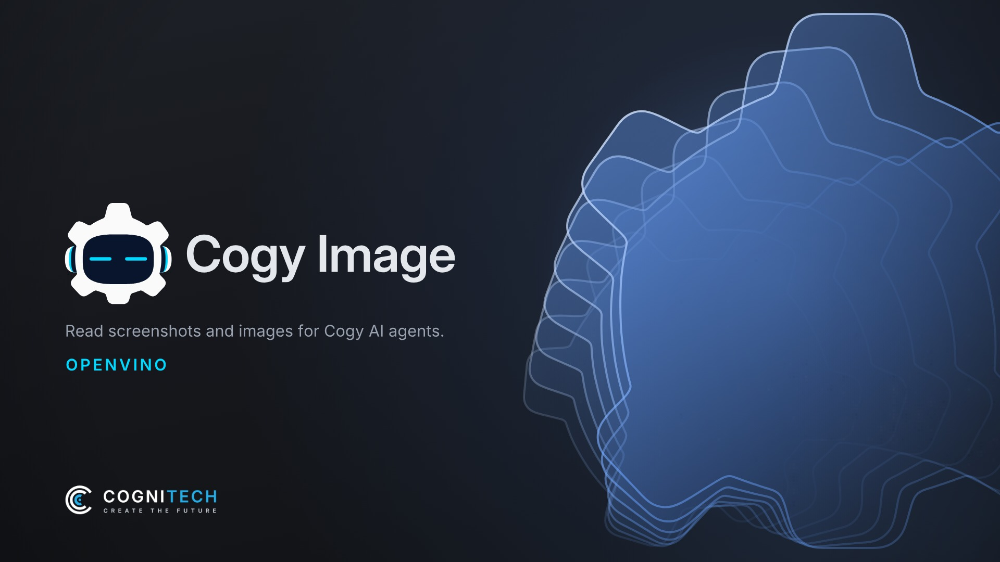

# Cogy Image: OpenVINO build

This build runs Cogy Image on a Windows PC with an Intel GPU. It uses
[OpenVINO Model Server](https://github.com/openvinotoolkit/model_server) (OVMS)
and Qwen3-VL-8B-Instruct, quantised to INT4.

## Contents

- [Overview](#overview)
- [Requirements](#requirements)
- [Installation](#installation)
- [API reference](#api-reference)
- [Configuration](#configuration)
- [Performance](#performance)
- [Operations](#operations)
- [Testing](#testing)
- [Uninstalling](#uninstalling)
- [Repository layout](#repository-layout)
- [Contributing](#contributing)
- [License](#license)

## Overview

| | |
|---|---|
| Model | [`OpenVINO/Qwen3-VL-8B-Instruct-int4-ov`](https://huggingface.co/OpenVINO/Qwen3-VL-8B-Instruct-int4-ov): 8B-parameter vision-language model, INT4 weights, about 5.1 GB |
| Model server | OVMS 2026.4.1 on `127.0.0.1:18812`, reachable only from this PC. The model needs OpenVINO 2026.4.1 or later. |
| Image service | [image/](image/), started by [image/image.py](image/image.py): Python 3.12, standard library only |
| Device | Intel GPU |
| Context | 16,384 tokens per request (image, caption and output) |
| Largest image | 2,073,600 pixels (1920 × 1080). Larger images are scaled down, to about 2,000 image tokens. |
| Concurrency | 2 requests in parallel |
| Endpoint | `http://<private-address>:8812` on Cogy Server's private network |
| Access | Windows Firewall admits port 8812 from Cogy Server only (`AllowFrom`) |
| Services | `CogyImage` (the image service) and `CogyImageModel` (OVMS): both start at boot and restart after a failure |

```
Cogy Code agent
    │  POST /api/images/inspect  {image, caption}
    ▼
Cogy Server                                  checks who the agent is
    │  POST /inspect  {image, caption}
    ▼
CogyImage        <private-address>:8812       image.py, run by WinSW
    │
    ▼
CogyImageModel   127.0.0.1:18812              ovms.exe
    │
    ▼
GPU
    │  findings
    ▼
Cogy Server
    │  findings
    ▼
Cogy Code agent
```

## Requirements

> **Install [Cogy Server](https://github.com/CogyCode/cogy-server) and
> [Cogy Code](https://github.com/CogyCode/cogy-code) first.** Cogy Server
> runs the private network this PC joins, gives out the join key and is the
> only caller Cogy Image admits; Cogy Code's agents send the screenshots.

| | |
|---|---|
| OS | Windows 10 or 11, x64 |
| GPU | Intel GPU with a current driver: Arc, or Core Ultra graphics. Tested on a Core Ultra 7 258V (Arc 140V) and a Core Ultra X7 358H (Arc B390). |
| Memory | 16 GB RAM at least, 32 GB recommended. The model server needs about 9.4 GB of GPU memory (see [GPU memory](#gpu-memory)). With 16 GB RAM that is more than Windows' default limit of half the RAM, so raise it with **Shared GPU Memory Override** in Intel Graphics Software. An Arc card with its own 12 GB or more needs no change. |
| Disk | About 8 GB free |
| Network | Access to Cogy Server's private network, and a join key if this PC is not on it yet |
| Rights | Administrator. The scripts ask through UAC. |

Nothing else needs to be installed first. The scripts download Tailscale,
OVMS, the model, Python and WinSW themselves.

## Installation

Run both steps from this directory in PowerShell.

### Step 1: Join the private network

Skip this step if the PC is already on Cogy Server's network.

1. Get a join key from **Cogy Server › Machines › Add a machine to the network**.
2. Run:

   ```powershell
   powershell -ExecutionPolicy Bypass -File .\join-network.ps1 -LoginServer http://<server-ip>:8780 -AuthKey <key>
   ```

   Give Cogy Server's IP address, not a `.local` name. The Tailscale service runs
   as SYSTEM and may not resolve mDNS names.

[join-network.ps1](join-network.ps1) does the following:
- installs Tailscale if it is missing, after checking its signature;
- joins the network with `--unattended`, so the connection survives reboots and
  logoffs;
- does nothing if the PC is already joined.

The join key is never written to a command line or a log.

#### A cloud machine

A cloud machine, outside Cogy Server's site, joins through an SSH tunnel that
Cogy Server opens to it, so no port at Cogy Server's site is opened to the
internet. Do this first, then run Step 1 as above:

1. On the cloud machine, turn on **OpenSSH Server** and set it to start
   automatically:

   ```powershell
   Set-Service sshd -StartupType Automatic
   Start-Service sshd
   ```

2. On Cogy Server, open a reverse tunnel to the network control port, bound
   to the cloud machine's `127.0.0.1` only:

   ```
   ssh -N -R 127.0.0.1:8780:127.0.0.1:8780 <user>@<cloud-machine>
   ```

3. On the cloud machine, check that `http://127.0.0.1:8780/health` answers,
   then run Step 1 with `-LoginServer http://127.0.0.1:8780`.

Keep the tunnel running. The machine needs it to rejoin the network after a
restart. Once joined, Cogy Server's requests and the images go over the
private network, not the tunnel.

### Step 2: Install Cogy Image

```powershell
powershell -ExecutionPolicy Bypass -File .\install.ps1
```

The installer stops if the PC is not on the private network. It is safe to
re-run, for example to upgrade or repair. It performs these steps:

1. **Model server:** downloads OVMS (pinned, SHA-256 checked) to `%ProgramData%\CogyImage\ovms`.
2. **Model:** downloads the model (about 5 GB) to `%ProgramData%\CogyImage\models`.
   It checks that the download is complete, including the image encoder, and
   removes models that are no longer configured.
3. **Configuration:** installs [config/config.json](config/config.json) and
   [config/graph.pbtxt](config/graph.pbtxt), sets the model's context to 16k,
   and sets the largest image size in the model's `processor_config.json`
   (the image section; OpenVINO reads it from there before
   `preprocessor_config.json`, which is set too).
4. **Network:** reads this PC's private address from Tailscale.
5. **Firewall:** adds the rule group *Cogy Image*, which allows TCP 8812 from
   `AllowFrom` and blocks it from every other source.
6. **Python and the service:** installs Python 3.12 (embeddable, pinned,
   SHA-256 checked) and [image/](image/) to `%ProgramData%\CogyImage`.
7. **Services:** creates the two services:
   - `CogyImageModel` runs OVMS, bound to `127.0.0.1`.
   - `CogyImage` runs the image service through
     [WinSW](https://github.com/winsw/winsw), bound to the private address.
     It is set to delayed start and waits for OVMS and Tailscale.
8. **Self-test:** runs [scripts/verify.ps1](scripts/verify.ps1) `-SelfTest`,
   which waits for the model to load, then sends a generated screenshot to
   `/inspect`, without a caption, and checks that the model reads its text
   back. It also tests a chat completion. The installer fails if a check
   fails.

The first start compiles the model for the GPU, which takes about a minute.
Later starts load it from `%ProgramData%\CogyImage\cache` in seconds.

When it finishes, the installer prints the endpoint. The full log is in
`%ProgramData%\CogyImage\logs\install.log`.

## API reference

Base URL: `http://<private-address>:8812`

| Method | Path | Description |
|---|---|---|
| `POST` | `/inspect` | Read an image and return findings |
| `GET` | `/health` | Service and model status |
| `GET` | `/v3/models` | OpenAI API: list models (passed through to OVMS) |
| `POST` | `/v3/chat/completions` | OpenAI API: chat completion, with `image_url` content parts as `data:` URLs (passed through to OVMS, streaming supported) |

`/v1/...` paths are passed through in the same way as `/v3/...`. The model name
for OpenAI requests is `OpenVINO/Qwen3-VL-8B-Instruct-int4-ov`.

### `POST /inspect`

Request:

| Field | Type | Required | Description |
|---|---|---|---|
| `image` | string | Yes | The image as base64, or as a `data:image/...;base64,` URL. PNG, JPEG, GIF or WebP, at most 10 MB. |
| `caption` | string | No | What the caller expects the image to show, at most 4,000 characters. The model checks it against the image and does not assume it is true. |

```bash
curl -s http://<private-address>:8812/inspect \
  -H "Content-Type: application/json" \
  -d "{\"image\": \"$(base64 -w0 screenshot.png)\", \"caption\": \"The Save button is disabled\"}"
```

Response (`200`):

| Field | Description |
|---|---|
| `findings` | What is visible, then visible defects or uncertainty |
| `truncated` | `true` if the findings were cut off at the output limit (1,200 tokens) |
| `model` | Model that read the image |
| `media_type` | The image's type, from its content |
| `seconds` | Time taken |
| `usage` | Prompt and completion token counts, as OVMS reports them. OVMS counts the text only: the image's tokens are not in `prompt_tokens`. |

Errors return `{"error": "<message>"}`:

| Status | Meaning |
|---|---|
| `400` | The body is not a JSON object, `image` is missing or not base64, or `caption` is not a string or is too long |
| `413` | The image is over 10 MB, or the image and caption are too long for the context |
| `415` | `image` is not a PNG, JPEG, GIF or WebP image |
| `502` | The model server is unreachable or returned an error, or the model returned no findings |

### `GET /health`

```json
{"service": "cogy-image", "status": "ready", "model": "OpenVINO/Qwen3-VL-8B-Instruct-int4-ov", "detail": null}
```

Returns `200` when the model is loaded and `503` otherwise.

### OpenAI passthrough

Requests go to OVMS unchanged, except that an `image_url` must be a `data:`
URL; any other is refused with `400`. OVMS can fetch URLs and read local file
paths given as `image_url`, so otherwise a caller could make the PC fetch
from its network or read its files. Send images as `image_url` content
parts:

```json
{"model": "OpenVINO/Qwen3-VL-8B-Instruct-int4-ov", "max_tokens": 300,
 "messages": [{"role": "user", "content": [
   {"type": "text", "text": "What does this screen show?"},
   {"type": "image_url", "image_url": {"url": "data:image/png;base64,..."}}]}]}
```

Passthrough requests do not get `/inspect`'s output limit, so set `max_tokens`
on them.

## Configuration

All settings live in the build directory. Edit them, then re-run `install.ps1`.

| File | Contents |
|---|---|
| [config/settings.psd1](config/settings.psd1) | Service names, ports, allowed callers, pinned versions and hashes, model, context length, largest image, output limit, request timeout |
| [config/config.json](config/config.json) | OVMS model list |
| [config/graph.pbtxt](config/graph.pbtxt) | OVMS pipeline: device, KV cache size and precision, request slots, prefix caching |
| [config/service.xml](config/service.xml) | WinSW service definition for the image service |
| [config/inspect-prompt.txt](config/inspect-prompt.txt) | Inspection system prompt (the same as Cogy Code's) |

### Allowed callers

`AllowFrom` lists the addresses and CIDR ranges that may call the API. The
default is Cogy Server alone, and it must be set before installing: put Cogy
Server's private address in [config/settings.psd1](config/settings.psd1). Cogy Code agents set to have their
screenshots read on the server (`images: server`) send them to Cogy Server's
`POST /api/images/inspect` through their node, and Cogy Server sends them
here. To admit other machines as well, add their private addresses or a range:

```powershell
AllowFrom = @('<cogy-server-address>', '<other-address>')
```

Each inspection in `image.log` names the address it came from.

### GPU memory

| Item | Size |
|---|---|
| Weights | About 5.1 GB |
| KV cache | 3 GB, set by `cache_size`, at u8 precision |
| OVMS process in total | 9.4 GB of shared GPU memory, measured |

The model has 36 layers with 8 KV heads of 128 dims, about 72 KB per token at
u8, so two requests at the full 16k context need about 2.4 GB of the KV cache.

### Image size

`MaxImagePixels` caps the pixels the model sees. Qwen3-VL uses one image token
for each 32 × 32 pixels, so a 1920 × 1080 screenshot costs about 2,000 tokens
and an unscaled 4K one about 8,000. Raise the cap to read small text in large
screenshots; lower it for faster inspections.

## Performance

Measured with [scripts/benchmark.ps1](scripts/benchmark.ps1) and
[scripts/verify.ps1](scripts/verify.ps1), with OVMS 2026.4.1, on a Core
Ultra 7 258V (Arc 140V, 32 GB, driver 32.0.101.9033) and a Core Ultra X7
358H (Arc B390, 64 GB):

| Metric | Core Ultra 7 258V | Core Ultra X7 358H |
|---|---|---|
| `/inspect`, 1920 × 1080 screenshot | 5.9 s median (4.7–7.2 s), 30–50 tokens of findings | 4.3 s median (3.7–4.3 s), 39–49 tokens of findings |
| 4K screenshot (scaled down to 1920 × 1080) | About 5 s | 2.6 s |
| 2 inspections at once | 8 s for both | 8.3 s for both |
| Generation, 1 request | 20.5 tok/s | 21.8 tok/s median (20.9–22.5) |
| GPU memory, model server | 9.4 GB shared | 9.52 GB shared |
| First start (compiling for the GPU) | About 45 s | About a minute |
| Install, including downloads | — | 7 min 37 s |

Generation is limited by memory bandwidth. Two requests at once share it, so
each gets about half the speed. The 358H generates only a little faster than
the 258V.

### On a cloud machine

The 358H was measured as a [cloud machine](#a-cloud-machine), in a data
centre in Oregon, USA, serving Cogy Code on a developer's machine in the UK.
Cogy Code's agent was working on real jobs, and its screenshot evidence went
to Cogy Server, then from Cogy Server to Cogy Image in Oregon. The network
there blocks UDP, so the hop from Cogy Server goes through a Tailscale relay
(DERP) in London, Cogy Server's home relay, with a round trip of about
160 ms. Five screenshots from the agent's real jobs were read in 3.8–5.1 s
(median 4.4 s), the same as the benchmark. The relay adds the time to transfer each image on top of that.
Relays pass on encrypted traffic only, so images stay private.

If you are interested in trying Cogy Image on Intel's AI Cloud PC,
[contact us](https://www.cognitech.systems/contact).

## Operations

### Services

| Service | Runs | Listens on | Start | On failure |
|---|---|---|---|---|
| `CogyImageModel` | `ovms.exe` | `127.0.0.1:18812` | Automatic | Restart |
| `CogyImage` | `image.py` (WinSW) | `<private-address>:8812` | Automatic (delayed), after OVMS and Tailscale | Restart |

```powershell
Get-Service CogyImage, CogyImageModel
Restart-Service CogyImageModel, CogyImage
```

The model takes a short while to load after a start. Until then, `/health`
returns `503`.

### Logs

In `%ProgramData%\CogyImage\logs`:

| File | Contents |
|---|---|
| `install.log` | Installer output |
| `join-network.log` | Network join output, with the key removed |
| `image.log` | The image service: startup, and each inspection with its caller's address, timing and token counts (rotated at 5 MB) |
| `ovms.log` | Model server: model loading, and the request queue and KV cache usage |
| `CogyImage.*.log` | WinSW service wrapper |
| `verify.log` | Output of the last [verify.ps1](scripts/verify.ps1) run |

### Troubleshooting

| Symptom | Check |
|---|---|
| `/health` returns `503` | The model is still loading. Watch `ovms.log`. |
| The model fails to load with `CL_OUT_OF_RESOURCES` | GPU memory limit: see [Requirements](#requirements) |
| The download fails with "has no image encoder" | The model in `ModelId` is not a vision model, or its download is incomplete. Re-run `install.ps1`. |
| A caller cannot connect | Run `tailscale status`, check that the caller's address is in `AllowFrom` and that the *Cogy Image* firewall rules exist, and run `scripts\verify.ps1` |
| A cloud machine is off the private network after a restart | It rejoins through the [SSH tunnel](#a-cloud-machine). Start the tunnel from Cogy Server, check that `sshd` is running and set to start automatically, then check `tailscale status`. |
| Small text in large screenshots is misread | Raise `MaxImagePixels`, then re-run `install.ps1` |
| Requests are slow | In `ovms.log`, look at `All requests` (queued) and `Scheduled requests` (running). Long passthrough requests without `max_tokens` hold a slot. |

## Testing

```powershell
powershell -ExecutionPolicy Bypass -File .\scripts\verify.ps1 [-TestRestart] [-SkipContext]
powershell -ExecutionPolicy Bypass -File .\scripts\verify.ps1 -SelfTest
powershell -ExecutionPolicy Bypass -File .\scripts\benchmark.ps1
& "$env:ProgramData\CogyImage\python\python.exe" -m unittest discover -s image
```

| Test | Checks |
|---|---|
| [scripts/verify.ps1](scripts/verify.ps1) | **Services:** both running, start at boot, restart on failure, and start in the right order. **Network:** listen addresses and firewall rules. **API:** `/health`; `/inspect` reads the text of a generated screenshot; a missing image and a non-image are refused; chat passthrough with text and with an image; a passthrough image given as a file path is refused. **Image size:** a 4K screenshot is scaled down. **Parallel:** 2 requests run together. **Context:** a prompt just under 16k tokens is served, and one just over is refused. With `-TestRestart`, it also kills both processes and checks that they come back. `-SelfTest` runs only the API checks (`/health`, `/inspect` and a chat completion) and needs no administrator rights; the installer uses it. |
| [scripts/benchmark.ps1](scripts/benchmark.ps1) | Inspection time, generation speed, and GPU memory |
| [image/test_image.py](image/test_image.py) | Unit tests for the image service modules, against a simulated model server |

## Uninstalling

```powershell
powershell -ExecutionPolicy Bypass -File .\uninstall.ps1                # services and firewall rules
powershell -ExecutionPolicy Bypass -File .\uninstall.ps1 -RemoveFiles   # also %ProgramData%\CogyImage
```

`-RemoveFiles` also deletes OVMS, the model, Python, the service code and the
logs. The PC stays on the private network. To leave it, run `tailscale logout`.

## Repository layout

```
openvino/
├── join-network.ps1          Step 1: join Cogy Server's private network
├── install.ps1               Step 2: install Cogy Image
├── uninstall.ps1             Remove Cogy Image
├── config/                   Settings, OVMS configuration, service definition, prompt
├── lib/                      Helpers shared by the scripts
│   ├── common.ps1            Output, elevation and native commands; loads the others
│   ├── network.ps1           Address ranges, firewall rules, private network
│   ├── components.ps1        Pinned downloads: OVMS, Python and the model
│   ├── services.ps1          Windows service control
│   └── selftest.ps1          Readiness polling and the test screenshot
├── image/                    The image service and its unit tests
│   ├── image.py              Entry point: command line, config, logging
│   ├── server.py             HTTP API and passthrough
│   ├── inspector.py          Inspection requests to the model
│   ├── upstream.py           Model server client
│   ├── imagedata.py          Image decoding and type detection
│   ├── errors.py             InspectError
│   └── test_image.py         Unit tests
└── scripts/                  Requirement checks (also the installer's self-test) and benchmark
```

## Contributing

Contributions are welcome. Read [CONTRIBUTING.md](../CONTRIBUTING.md) first: it
covers the rules every change follows, the tests to run and how to open a
pull request. Large AI-generated pull requests will be rejected.

## License

Copyright (C) 2026 CogniTech Systems LTD.

Cogy Image is licensed under the MIT License. See [LICENSE](../LICENSE).
