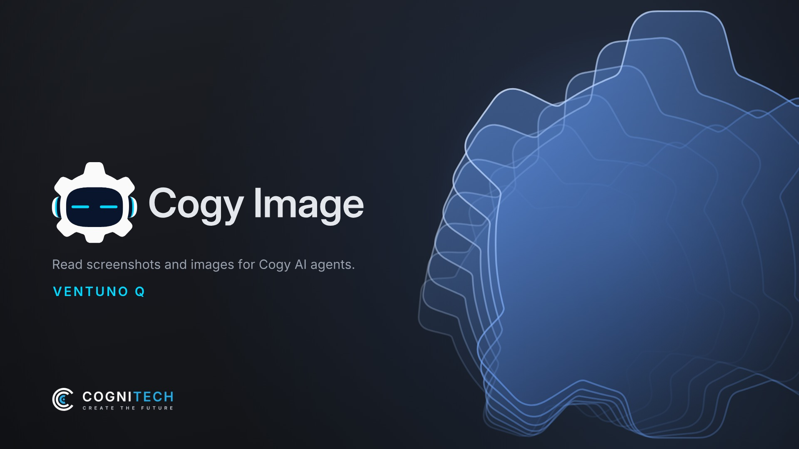

# Cogy Image: VENTUNO Q build

This build runs Cogy Image on an [Arduino VENTUNO Q](https://docs.arduino.cc/hardware/ventuno-q/),
a board built on the Qualcomm Dragonwing IQ8 (QCS8275). It uses Qualcomm's
[GenieX](https://github.com/qualcomm/GenieX) runtime and Qwen3-VL-4B-Instruct,
precompiled by Qualcomm AI Hub for the QCS8275's NPU.

## Contents

- [Overview](#overview)
- [How it differs from the OpenVINO build](#how-it-differs-from-the-openvino-build)
- [Requirements](#requirements)
- [Installation](#installation)
- [API reference](#api-reference)
- [Configuration](#configuration)
- [Performance](#performance)
- [Operations](#operations)
- [Testing](#testing)
- [Uninstalling](#uninstalling)
- [Repository layout](#repository-layout)
- [Contributing](#contributing)
- [License](#license)

## Overview

| | |
|---|---|
| Model | [Qwen3-VL-4B-Instruct](https://aihub.qualcomm.com/models/qwen3_vl_4b_instruct): 4B-parameter vision-language model, w4a16, AI Hub release v0.67.0 (QAIRT 2.51) for the QCS8275. About 3.0 GB to download. |
| Model server | GenieX v0.12.0 (`geniex serve`, QAIRT 2.51 plugin) on `127.0.0.1:18812`, reachable only from this board |
| Image service | [image/](image/): the system Python 3, standard library only |
| Device | NPU: Hexagon v75 (HTP), through FastRPC |
| Context | 4,096 tokens per request (image, caption and output). The model bundle is compiled for this size. |
| Image size | Every image is resized to 512 × 512 pixels: 256 image tokens. The bundle's vision encoder takes only this size. |
| Concurrency | 1. GenieX runs requests one after the other; others wait their turn. |
| Endpoint | `http://<private-address>:8812` on Cogy Server's private network |
| Access | nftables admits port 8812 from Cogy Server only (`ALLOW_FROM`), and from the board itself for its self-test |
| Services | systemd units `cogy-image` (the image service) and `cogy-image-model` (GenieX), plus `cogy-image-firewall`: all start at boot; the services restart after any exit |

```
Cogy Code agent
    │  POST /api/images/inspect  {image, caption}
    ▼
Cogy Server                                  checks who the agent is
    │  POST /inspect  {image, caption}
    ▼
cogy-image       <private-address>:8812       image.py, run by systemd
    │
    ▼
cogy-image-model 127.0.0.1:18812              geniex serve (QAIRT)
    │
    ▼
NPU
    │  findings
    ▼
Cogy Server
    │  findings
    ▼
Cogy Code agent
```

## How it differs from the OpenVINO build

The API is the same: `POST /inspect` and `GET /health` take and return the
same fields, so Cogy Server can use either build. The differences:

| | OpenVINO build | This build |
|---|---|---|
| Model | Qwen3-VL-8B (INT4) | Qwen3-VL-4B (w4a16) |
| Image the model sees | Up to 1920 × 1080, aspect ratio kept | Always 512 × 512 |
| Context | 16,384 tokens | 4,096 tokens |
| Requests in parallel | 2 | 1 (queued) |
| OpenAI passthrough | `/v3/...` (and `/v1/...`) | `/v1/...`; `/v3/...` is accepted as an alias |

**Small text.** A 1920 × 1080 screenshot is shrunk to 512 × 512, about a
quarter of its width, so small UI text (under about 14 px tall in the
original) may be unreadable. This build suits checking what a screen shows
(dialogs, banners, buttons, layout) more than reading fine print. Crop the
screenshot to the region of interest before sending it if small text
matters.

## Requirements

> **Install [Cogy Server](https://github.com/CogyCode/cogy-server) and
> [Cogy Code](https://github.com/CogyCode/cogy-code) first.** Cogy Server
> runs the private network this board joins, gives out the join key and is the
> only caller Cogy Image admits; Cogy Code's agents send the screenshots.

| | |
|---|---|
| Board | Arduino VENTUNO Q (Dragonwing IQ8, QCS8275, 16 GB). The model is compiled for the QCS8275's NPU; the installer warns on other SoCs. |
| OS | The board's Ubuntu image (ARM64) with Qualcomm's drivers: FastRPC (`qcom-fastrpc1`, providing `libcdsprpc.so` and `/dev/fastrpc-cdsp*`) and Adreno (`qcom-adreno1`). The installer installs these from Qualcomm's PPA if they are missing. |
| Memory | About 4.5 GB for the model (weights, embedding table and vision encoder), from the board's 16 GB |
| Disk | About 8 GB free in `/var/lib` during installation (download and import); about 4 GB after |
| Network | Access to Cogy Server's private network, and a join key if the board is not on it yet. Internet access to download GenieX, the model and packages. |
| Rights | root. The scripts re-run themselves with `sudo`. |

Nothing else needs to be installed first.

## Installation

Copy this directory to the board (for example `git clone`, or `scp -r`) and
run both steps from it. Keep the files' LF line endings: the
[.gitattributes](.gitattributes) keeps them in any checkout.

### Step 1: Join the private network

Skip this step if the board is already on Cogy Server's network.

1. Get a join key from **Cogy Server › Machines › Add a machine to the network**.
2. Run:

   ```bash
   ./join-network.sh --login-server http://<server-ip>:8780
   ```

   It asks for the join key, so the key is not typed on the command line or
   kept in the shell history (`--auth-key <key>` is accepted too). Give
   Cogy Server's IP address, not a `.local` name.

[join-network.sh](join-network.sh) does the following:
- installs Tailscale if it is missing, from Tailscale's apt repository, after
  checking the repository signing key's fingerprint;
- joins the network; `tailscaled` keeps the connection across reboots;
- does nothing if the board is already joined.

The join key goes to Tailscale in a file readable only by root, never on a
command line, and never into the log.

### Step 2: Install Cogy Image

```bash
./install.sh
```

The installer stops if the board is not on the private network. It is safe to
re-run, for example to upgrade or repair. It performs these steps:

1. **Packages and NPU:** installs Python 3, nftables and the ACL tools; checks
   for FastRPC and the NPU's device (`/dev/fastrpc-cdsp*`), and installs the
   Qualcomm driver packages if they are missing.
2. **Service user and NPU access:** creates the system user `cogy-image` and
   the directories. Gives the user read/write access to the NPU's devices:
   through the device's group where that group has it (on the VENTUNO Q,
   `fastrpc` and `dmaheap`), otherwise through an ACL entry kept across
   reboots by a udev rule.
3. **GenieX:** downloads the GenieX CLI (pinned, SHA-256 checked) to
   `/opt/cogy-image/geniex`, and links the system's FastRPC libraries into it.
4. **Model:** downloads the AI Hub model bundle (pinned, SHA-256 checked, about
   3 GB), imports it into GenieX's model store in `/var/lib/cogy-image`, then
   deletes the download. Models that are no longer configured are removed.
5. **Network:** reads the board's private address from Tailscale.
6. **Firewall:** loads the nftables table `inet cogy_image`, which allows TCP
   8812 from `ALLOW_FROM` and drops it from every other source, and drops the
   model server's port from other machines. If ufw is active, it also allows
   port 8812 from `ALLOW_FROM` there.
7. **The service:** installs [image/](image/) to `/opt/cogy-image/image` and its
   configuration to `/etc/cogy-image/image.json`.
8. **systemd units:**
   - `cogy-image-model` runs `geniex serve`, bound to `127.0.0.1`, on the NPU.
     Once started, it loads the model (`image.py --warm-up`). The unit counts
     as started only when the model is loaded.
   - `cogy-image` runs the image service, bound to the private address. It
     starts after the model server, the firewall rules and Tailscale.
9. **Self-test:** runs [scripts/verify.py](scripts/verify.py) `--self-test`,
   which sends a generated screenshot to `/inspect`, without a caption, and
   checks that the model reads its text back. It also tests a chat
   completion. The installer fails if a check fails.

When it finishes, the installer prints the endpoint. The full log is in
`/var/log/cogy-image/install.log`.

## API reference

Base URL: `http://<private-address>:8812`

| Method | Path | Description |
|---|---|---|
| `POST` | `/inspect` | Read an image and return findings |
| `GET` | `/health` | Service and model status |
| `GET` | `/v1/models` | OpenAI API: list models (passed through to GenieX) |
| `POST` | `/v1/chat/completions` | OpenAI API: chat completion, with `image_url` content parts as `data:` URLs (passed through to GenieX, streaming supported) |

`/v3/...` paths are accepted as aliases of `/v1/...`, as the OpenVINO build
uses `/v3`. The model name for OpenAI requests is
`qualcomm/Qwen3-VL-4B-Instruct`; `/v1/models` lists it with its precision, as
`qualcomm/Qwen3-VL-4B-Instruct:W4A16`.

### `POST /inspect`

Request:

| Field | Type | Required | Description |
|---|---|---|---|
| `image` | string | Yes | The image as base64, or as a `data:image/...;base64,` URL. PNG, JPEG, GIF or WebP, at most 10 MB. |
| `caption` | string | No | What the caller expects the image to show, at most 4,000 characters. The model checks it against the image and does not assume it is true. |

```bash
curl -s http://<private-address>:8812/inspect \
  -H "Content-Type: application/json" \
  -d "{\"image\": \"$(base64 -w0 screenshot.png)\", \"caption\": \"The Save button is disabled\"}"
```

Response (`200`):

| Field | Description |
|---|---|
| `findings` | What is visible, then visible defects or uncertainty |
| `truncated` | `true` if the findings were cut off at the output limit (1,200 tokens) |
| `model` | Model that read the image |
| `media_type` | The image's type, from its content |
| `seconds` | Time taken, including any wait for an earlier request |
| `usage` | Prompt and completion token counts, as GenieX reports them |

Errors return `{"error": "<message>"}`:

| Status | Meaning |
|---|---|
| `400` | The body is not a JSON object, `image` is missing or not base64, or `caption` is not a string or is too long |
| `413` | The image is over 10 MB, or the image and caption are too long for the context |
| `415` | `image` is not a PNG, JPEG, GIF or WebP image, or the model could not decode it |
| `502` | The model server is unreachable or returned an error, or the model returned no findings |

### `GET /health`

```json
{"service": "cogy-image", "status": "ready", "model": "qualcomm/Qwen3-VL-4B-Instruct", "detail": null}
```

Returns `200` when the model is loaded and `503` otherwise, with `status`
`loading`, `unloaded` or `down`. (GenieX's own `/health` is `200` even when
no model is loaded, so this one reads GenieX's `/status`.)

### OpenAI passthrough

Requests go to GenieX unchanged, except that an `image_url` must be a `data:`
URL; any other is refused with `400`, as in the OpenVINO build. GenieX
fetches `http(s)` image URLs and reads local file paths given as
`image_url`, so otherwise a caller could make the board fetch from its
network or read its files. Send images as `image_url` content parts:

```json
{"model": "qualcomm/Qwen3-VL-4B-Instruct", "max_tokens": 300,
 "messages": [{"role": "user", "content": [
   {"type": "text", "text": "What does this screen show?"},
   {"type": "image_url", "image_url": {"url": "data:image/png;base64,..."}}]}]}
```

Passthrough requests do not get `/inspect`'s output limit, so set
`max_tokens` on them. While one runs, `/inspect` requests wait for it.

## Configuration

All settings live in the build directory. Edit them, then re-run `install.sh`.

| File | Contents |
|---|---|
| [config/settings.env](config/settings.env) | Unit names, ports, allowed callers, install directories, pinned versions, URLs and hashes, model, output limit, request timeout, NPU power mode |
| [config/cogy-image-model.service](config/cogy-image-model.service) | systemd unit for GenieX: flags, keepalive, warm-up, restart, hardening |
| [config/cogy-image.service](config/cogy-image.service) | systemd unit for the image service |
| [config/cogy-image-firewall.service](config/cogy-image-firewall.service), [config/firewall.nft](config/firewall.nft) | Firewall rules and the unit that loads them at boot |
| [config/inspect-prompt.txt](config/inspect-prompt.txt) | Inspection system prompt (the same as Cogy Code's) |

### Allowed callers

`ALLOW_FROM` lists the IPv4 addresses and CIDR ranges that may call the API,
separated by spaces. It must list Cogy Server's private address before installing: set it in
[config/settings.env](config/settings.env). Cogy Code
agents set to have their screenshots read on the server (`images: server`)
send them to Cogy Server's `POST /api/images/inspect` through their node, and
Cogy Server sends them here. To admit other machines as well:

```bash
ALLOW_FROM='<cogy-server-address> <other-address>'
```

Each inspection in `image.log` names the address it came from.

### Memory

| Item | Size |
|---|---|
| Language model weights (4 context binaries) | About 2.35 GB |
| Embedding table (float32, memory-mapped) | About 1.56 GB |
| Vision encoder | About 0.43 GB |

The NPU uses the board's shared memory. The KV cache is part of the
compiled context binaries, sized for the 4,096-token context.

### NPU power mode

`POWER_MODE` sets the NPU's clock mode (`burst` by default, the fastest).
On a board without a fan, `sustained_high_performance` may give steadier
speed over long runs.

### Changing the model or GenieX

`MODEL_URL` and `MODEL_SHA256` name an AI Hub GenieX/QAIRT bundle for the
QCS8275 (file name `...-geniex_qairt-...-qualcomm_qcs8275.zip`). The context
length and image size are fixed by the bundle. Set `CONTEXT_LENGTH` and
`IMAGE_SIZE` to match the new bundle's `genie_config.json` and
`metadata.json`, because the checks use them.

Upgrade GenieX and the model together. Each AI Hub bundle is compiled with
one QAIRT version and loads only in a GenieX release that ships the same
version: the pinned bundle (AI Hub v0.67.0) needs QAIRT 2.51, which GenieX
v0.12.0 ships. A mismatch fails at load with `Create From Binary FAILED`.

## Performance

Measured on a VENTUNO Q (QCS8275, 16 GB) with
[scripts/benchmark.py](scripts/benchmark.py) and `POWER_MODE=burst`:

| | |
|---|---|
| Inspection of a 1920 × 1080 screenshot | 5.6 s (median of 3; 64–112 tokens written) |
| Generation speed | 15.1 tokens/s (median, 256 tokens) |
| Time to first token (text only) | 0.15 s |
| Two inspections at once | 11.8 s for both (run one after the other) |
| Model load at start | About 12 s |
| Model server memory | 1.78 GB resident (the weights are memory-mapped); 4.9 GB left available |

A 4K screenshot reads in about the same time as a 1920 × 1080 one, as every
image is resized to 512 × 512 first.

For comparison, Qualcomm AI Hub publishes these generation speeds for this
model on the IQ-8275 (GenieX QAIRT, w4a16):

| Context in use | Tokens/s |
|---|---|
| 512 | 16.4 |
| 1,024 | 15.3 |
| 2,048 | 14.2 |
| 4,096 | 12.0 |

## Operations

### Services

| Unit | Runs | Listens on | Start | On exit |
|---|---|---|---|---|
| `cogy-image-model` | `geniex serve` | `127.0.0.1:18812` | At boot; counts as started once the model is loaded | Restart after 10 s |
| `cogy-image` | `image.py` | `<private-address>:8812` | At boot, after the model server, firewall and Tailscale | Restart after 10 s |
| `cogy-image-firewall` | `nft -f /etc/cogy-image/firewall.nft` | | At boot, before the network | |

```bash
systemctl status cogy-image cogy-image-model
sudo systemctl restart cogy-image-model     # also restarts cogy-image
```

**Stopping the model server.** GenieX releases the NPU's buffers when it gets
SIGTERM, which `systemctl stop` and `restart` send. A `kill -9` leaves those
buffers reserved until the next reboot, so do not use one. The unit gives
GenieX 90 seconds to shut down.

### Logs

| Where | Contents |
|---|---|
| `/var/log/cogy-image/install.log` | Installer output |
| `/var/log/cogy-image/join-network.log` | Network join output, with the key removed |
| `/var/log/cogy-image/image.log` | The image service: startup, and each inspection with its caller's address, timing and token counts (rotated at 5 MB) |
| `journalctl -u cogy-image-model` | GenieX: model loading, warm-up, requests and errors |
| `journalctl -u cogy-image` | The image service's start and stop |
| `/var/log/cogy-image/verify.log` | Output of the last [verify.py](scripts/verify.py) run |

### Troubleshooting

| Symptom | Check |
|---|---|
| `/health` returns `503` `loading` | The model is still loading. Watch `journalctl -u cogy-image-model -f`. |
| `/health` returns `503` `unloaded` | GenieX is running without the model. Restart `cogy-image-model`; its warm-up loads it. |
| `cogy-image-model` fails to start | `journalctl -u cogy-image-model`. Run `sudo -u cogy-image test -w /dev/fastrpc-cdsp && echo ok` to check NPU access, and check that `libcdsprpc.so` is linked in `/opt/cogy-image/geniex`. |
| The model fails to load after a crash | A killed GenieX can leave the NPU's buffers reserved: reboot the board. |
| The model fails to load after an upgrade, with `Failed to create device: 14001` | An old `geniex serve` is still running with the previous libraries. Stop it, or re-run `install.sh`, which stops it in any state. |
| The model fails to load with `Create From Binary FAILED` | GenieX's QAIRT version does not match the model bundle's: see [Changing the model or GenieX](#changing-the-model-or-geniex). |
| A GIF or WebP image returns `415` | GenieX's image decoder does not read that type. Send PNG or JPEG. |
| A caller cannot connect | Run `tailscale status`, check that the caller's address is in `ALLOW_FROM`, run `sudo nft list table inet cogy_image` (the drop counter shows refused connections), and run `scripts/verify.py` |
| Small text is misread | Images are resized to 512 × 512. Send a crop of the region of interest. |
| Requests are slow | Requests run one at a time: a long passthrough request without `max_tokens` holds up the others. |

## Testing

```bash
sudo python3 scripts/verify.py [--test-restart] [--skip-context]
python3 scripts/benchmark.py
python3 -m unittest discover -s image
```

| Test | Checks |
|---|---|
| [scripts/verify.py](scripts/verify.py) | **Services:** all three running and starting at boot, the two services restarting after any exit, and starting in the right order. **Network:** listen addresses and firewall rules. **API:** `/health`; `/inspect` reads the text of a generated screenshot; a missing image and a non-image are refused; chat passthrough with text and with an image; a passthrough image given as a file path is refused. **Image size:** a 4K screenshot reads in about the time of a 1920 × 1080 one. **Two at once:** both are answered. **Context:** a prompt just under 4,096 tokens is served, and one just over is refused. With `--test-restart`, it also kills the image service, stops GenieX with SIGTERM (see [Stopping the model server](#services)), and checks that both come back. `--self-test` runs only the API checks; the installer uses it. |
| [scripts/benchmark.py](scripts/benchmark.py) | Inspection time, generation speed, time to first token, two inspections at once, and memory |
| [image/test_image.py](image/test_image.py) | Unit tests for the image service, against a simulated GenieX server |
| [scripts/testimage.py](scripts/testimage.py) | Draws the test screenshots: a standard-library PNG writer with a built-in pixel font, so the tests need no image library or fonts |

## Uninstalling

```bash
./uninstall.sh                  # units, firewall rules, ufw rules, NPU udev rule
./uninstall.sh --remove-files   # also /opt, /etc, /var/lib and /var/log cogy-image, and the user
```

`--remove-files` also deletes GenieX, the model, the service code, the
configuration and the logs. The board stays on the private network. To leave
it, run `sudo tailscale logout`.

## Repository layout

```
ventuno-q/
├── join-network.sh           Step 1: join Cogy Server's private network
├── install.sh                Step 2: install Cogy Image
├── uninstall.sh              Remove Cogy Image
├── config/                   Settings, systemd units, firewall rules, prompt
├── lib/common.sh             Helpers shared by the scripts
├── image/                    The image service and its unit tests
│   ├── image.py              Entry point: command line, config, logging, warm-up
│   ├── server.py             HTTP API and passthrough
│   ├── inspector.py          Inspection requests to the model
│   ├── upstream.py           GenieX client, model state and warm-up
│   ├── imagedata.py          Image decoding and type detection
│   ├── errors.py             InspectError
│   └── test_image.py         Unit tests
└── scripts/                  Checks, benchmark and test screenshots
```

## Contributing

Contributions are welcome. Read [CONTRIBUTING.md](../CONTRIBUTING.md) first: it
covers the rules every change follows, the tests to run and how to open a
pull request. Large AI-generated pull requests will be rejected.

## License

Copyright (C) 2026 CogniTech Systems LTD.

Cogy Image is licensed under the MIT License. See [LICENSE](../LICENSE).
